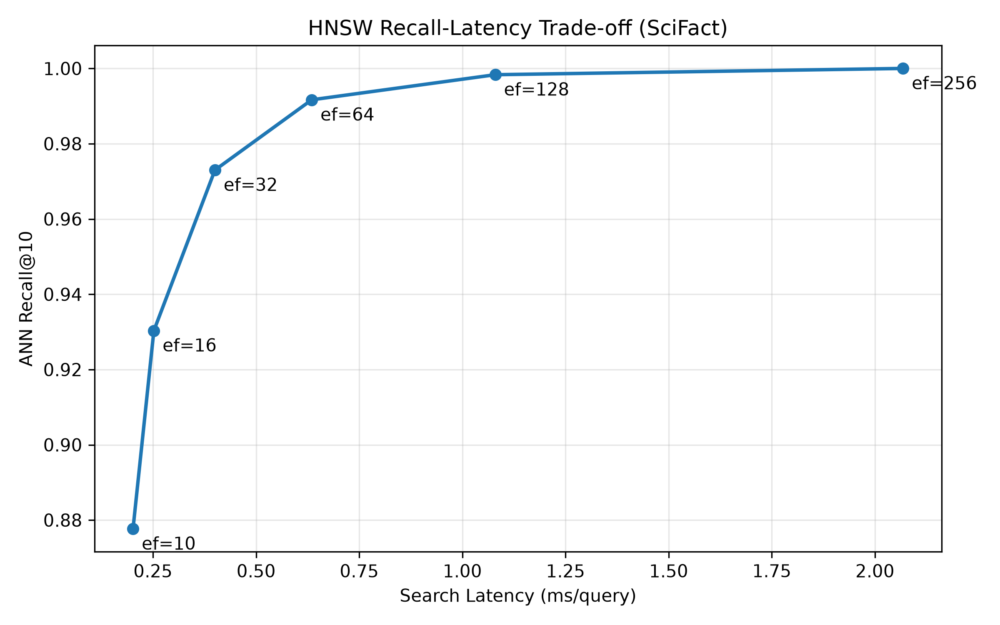

# Dense Retrieval Engine: Exact Search and HNSW Benchmark

A hands-on Information Retrieval project exploring dense vector representations, exact similarity search, and Approximate Nearest Neighbor (ANN) retrieval using FAISS and HNSW.

This project implements a dense retrieval pipeline, evaluates retrieval effectiveness on the SciFact dataset, and benchmarks the trade-offs between search accuracy, latency, and index storage.

## 1. Project Overview

Dense retrieval represents queries and documents as continuous vectors in a shared embedding space. Relevant documents are retrieved by comparing their vector representations.

However, exact nearest neighbor search requires comparing each query against every indexed document, which can become computationally expensive as the collection grows.

Approximate Nearest Neighbor (ANN) algorithms, such as HNSW, aim to reduce search costs while maintaining high agreement with exact search.

This project investigates three questions:

1. How can dense retrieval be implemented using sentence embeddings and cosine similarity?
2. How effectively does a pretrained embedding model retrieve relevant scientific documents?
3. How does HNSW trade retrieval accuracy for search latency and index storage?

## 2. Implementation

The project is organized into three Jupyter Notebooks.

### Notebook 01: Dense Retrieval Basics

**File:** `notebooks/01_dense_retrieval_basics.ipynb`

Implements the fundamental operations of dense retrieval using a small collection of five documents.

Key components:

- Sentence embedding generation using Sentence Transformers
- Manual cosine similarity computation
- Top-K document ranking
- Reusable dense retrieval function
- L2 normalization
- Vectorized similarity search using NumPy
- Correctness verification between loop-based and vectorized implementations

### Notebook 02: Retrieval Evaluation

**File:** `notebooks/02_retrieval_evaluation.ipynb`

Implements an exact dense retrieval pipeline using the SciFact dataset from BEIR.

Key components:

- Loading the SciFact corpus, queries, and relevance judgments
- Generating normalized 384-dimensional embeddings
- Exact similarity search using matrix multiplication
- Efficient Top-K selection using `np.argpartition()`
- Evaluating retrieval effectiveness using Recall@10 and nDCG@10
- Saving embeddings and evaluation results

### Notebook 03: ANN Benchmark

**File:** `notebooks/03_ann_benchmark.ipynb`

Benchmarks exact and approximate vector search using FAISS.

Key components:

- Exact search with `IndexFlatIP`
- Approximate search with `IndexHNSWFlat`
- Verification against NumPy exact search
- ANN Recall@10 evaluation
- Search latency benchmarking
- HNSW `efSearch` parameter sweep
- Serialized index size comparison
- Recall-latency trade-off visualization

## 3. Dataset and Embedding Model

### Dataset

**SciFact (BEIR)**

| Property | Value |
|---|---|
| Documents | 5,183 |
| Evaluation Queries | 300 |
| Domain | Scientific fact verification |

### Embedding Model

**Model:** `sentence-transformers/all-MiniLM-L6-v2`

| Property | Value |
|---|---|
| Embedding Dimension | 384 |
| Similarity Metric | Cosine Similarity |
| Normalization | L2 Normalization |

For L2-normalized embeddings, cosine similarity is equivalent to inner product:

$$
\operatorname{cosine}(q,d) = \hat{q} \cdot \hat{d}
$$

This allows the same vector representations to be used for NumPy-based exact search and FAISS inner product indexes.

## 4. Experimental Results

### 4.1 Exact Dense Retrieval Quality

The dense retrieval pipeline was evaluated against SciFact ground-truth relevance judgments.

| Metric | Result |
|---|---:|
| Recall@10 | 0.7833 |
| nDCG@10 | 0.6451 |

**Recall@10** measures the proportion of relevant documents retrieved within the Top-10 results.

**nDCG@10** additionally considers the ranking positions of relevant documents.

These metrics evaluate retrieval effectiveness against the dataset's relevance judgments.

### 4.2 Exact Search vs. HNSW

We compare FAISS `IndexFlatIP` against `IndexHNSWFlat`.

HNSW configuration:

- `M = 16`
- `efConstruction = 100`
- `efSearch = 32`

| Metric | IndexFlatIP | IndexHNSWFlat |
|---|---:|---:|
| Search Time (ms/query) | 3.6973 | 0.4281 |
| ANN Recall@10 | 1.0000 | 0.9730 |
| Serialized Index Size (MiB) | 7.5923 | 8.3038 |

At `efSearch = 32`, HNSW achieved approximately **8.64x faster search** while recovering **97.3% of the exact Top-10 nearest neighbors**.

**Important distinction:**

- Retrieval Recall@10 measures agreement with SciFact ground-truth relevance judgments.
- ANN Recall@10 measures agreement with the exact nearest neighbor results returned by `IndexFlatIP`.

The latency measurements represent average batch search time divided by the number of queries, using a single FAISS CPU thread.

### 4.3 HNSW Recall-Latency Trade-off

We evaluate different `efSearch` values to investigate the trade-off between approximate search accuracy and computational cost.

| efSearch | ANN Recall@10 | Search Time (ms/query) |
|---:|---:|---:|
| 10 | 0.8777 | 0.2016 |
| 16 | 0.9303 | 0.2521 |
| 32 | 0.9730 | 0.4002 |
| 64 | 0.9917 | 0.6347 |
| 128 | 0.9983 | 1.0796 |
| 256 | 1.0000 | 2.0681 |



Increasing `efSearch` generally improves ANN Recall@10 but also increases search time.

At `efSearch = 32`, HNSW achieves 97.3% ANN Recall@10 with approximately 0.40 ms/query in the parameter sweep.

At `efSearch = 128`, ANN Recall@10 increases to 99.83%, but search time also increases to approximately 1.08 ms/query.

These results demonstrate how HNSW can be tuned to balance search accuracy and performance.

### 4.4 Index Storage Comparison

| Index | Serialized Size |
|---|---:|
| IndexFlatIP | 7.5923 MiB |
| IndexHNSWFlat | 8.3038 MiB |

The HNSW index requires approximately **1.09x** the serialized storage of the Flat index.

This overhead comes from the additional graph connectivity information maintained by HNSW.

These measurements represent serialized index sizes, not peak runtime memory consumption.

## 5. Project Structure

```text
dense_retrieval/
├── notebooks/
│   ├── 01_dense_retrieval_basics.ipynb
│   ├── 02_retrieval_evaluation.ipynb
│   └── 03_ann_benchmark.ipynb
├── data/
│   └── scifact_embeddings.npy
├── results/
│   ├── exact_retrieval_metrics.json
│   ├── hnsw_benchmark.csv
│   ├── ann_benchmark_summary.json
│   └── hnsw_recall_latency.png
├── requirements.txt
├── .gitignore
└── README.md
```

The embedding file is generated locally and excluded from Git tracking.

## 6. Installation and Usage

### Prerequisites

- Python 3.11
- JupyterLab
- Required Python packages listed in `requirements.txt`

### Installation

Clone the repository:

```bash
git clone https://github.com/Weiting-Pan/dense-retrieval-engine.git
cd dense-retrieval-engine
```

Install the required dependencies:

```bash
python -m pip install -r requirements.txt
```

Launch JupyterLab:

```bash
jupyter lab
```

### Execution Order

Run the notebooks in the following order:

1. `01_dense_retrieval_basics.ipynb`
2. `02_retrieval_evaluation.ipynb`
3. `03_ann_benchmark.ipynb`

Notebook 02 generates `data/scifact_embeddings.npy`, which is required by Notebook 03.

The SciFact dataset and pretrained embedding model are downloaded automatically when the corresponding notebook code is executed for the first time.

Run JupyterLab from the project root or the `notebooks/` directory so that the notebook path-handling logic can locate the project folders.

## 7. Benchmark Methodology

The FAISS benchmark uses:

- A SciFact corpus of 5,183 document embeddings
- 300 evaluation queries
- 384-dimensional normalized embeddings
- FAISS CPU indexes
- Single-threaded FAISS execution
- Warm-up searches before timing
- Five repeated timing measurements

Search time is reported as the average batch execution time divided by the number of queries.

The measurements reflect the local experimental environment and may vary across different hardware, FAISS versions, and system configurations.

## 8. Key Findings

The experiments demonstrate that:

1. Dense retrieval can be implemented using normalized sentence embeddings and vectorized similarity computation.
2. Exact retrieval provides a reference for evaluating both retrieval effectiveness and approximate search correctness.
3. HNSW can significantly reduce search time while maintaining high agreement with exact nearest neighbor results.
4. Increasing `efSearch` improves ANN recall but increases search latency.
5. Graph-based ANN indexes introduce additional storage overhead compared with flat vector indexes.

These findings provide a foundation for further investigation into efficient retrieval systems, including graph-based indexing, index compression, and hybrid retrieval.

## 9. Technologies

- Python
- NumPy
- Pandas
- Matplotlib
- Sentence Transformers
- Hugging Face Datasets
- FAISS
- JupyterLab

## 10. References

- [FAISS: A Library for Efficient Similarity Search](https://github.com/facebookresearch/faiss)
- [Sentence Transformers](https://www.sbert.net/)
- [BEIR: A Heterogeneous Benchmark for Zero-shot Evaluation of Information Retrieval Models](https://arxiv.org/abs/2104.08663)
- [SciFact Dataset](https://github.com/allenai/scifact)
- [Efficient and Robust Approximate Nearest Neighbor Search Using Hierarchical Navigable Small World Graphs](https://arxiv.org/abs/1603.09320)
